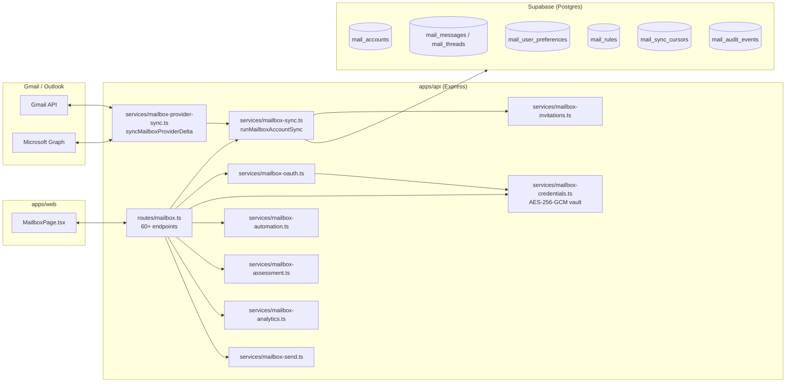

# Mailbox Architecture Guide

Mailbox is the unified, multi-provider inbox feature in Coordination Manager. It
connects Gmail and Outlook accounts, projects a normalized local copy of mail
for search/rules/AI, and layers automations, contacts, and calendar
invitation extraction on top. This guide documents the architecture as it
exists in code today. For the current endpoint catalog and request examples,
see the [Mailbox API reference](/api/mailbox). It supersedes the older
root-level `MAILBOX_SYNC_*` debug notes, which have been folded into this
architecture guide and into the `mailbox-feature` development skill
(`.claude/skills/mailbox-feature/SKILL.md`).

> **Note on aliases**: burner/forwarding email aliases (Addy.io) were removed
> from this codebase on 2026-09-03 -- the backend route/service/table existed
> but was never reachable from the product UI. Aliases remain a deferred
> proposal, not a shipped or in-progress feature; do not re-add alias code
> without re-reading that proposal first.

## 1. High-Level Architecture

**Design principle: local projection, not source of truth.** Gmail/Outlook
remain authoritative. The app stores a normalized read/search/automation
projection (`mail_messages`, `mail_threads`, etc.) and reconciles it against a
durable per-account sync cursor rather than trying to keep two mailboxes in
lockstep.

## 2. Backend Service Map

| Service | File | Responsibility |
|---|---|---|
| Route layer | `apps/api/src/services/../routes/mailbox.ts` | All `/api/mailbox/*` endpoints (60+); request validation, authorization, response shaping. |
| Account sync orchestration | `services/mailbox-sync.ts` | `runMailboxAccountSync()` -- marks account `syncing`, enforces a 120s timeout via `Promise.race`, classifies provider errors into user-facing messages, persists cursor + audit event. `runPersistedMailboxAutoSync()` drives the background auto-sync loop and recovers accounts stuck in `syncing` for >3 minutes. |
| Provider delta sync | `services/mailbox-provider-sync.ts` | Talks to Gmail API / Microsoft Graph directly. Fetches message deltas, sanitizes HTML (`sanitize-html`), derives contacts from correspondence, applies junk-domain filtering, batches provider detail fetches and DB upserts for throughput. |
| OAuth | `services/mailbox-oauth.ts` | Builds provider auth URLs, signs expiring state, atomically consumes browser-bound transactions, exchanges codes, and refreshes access tokens. |
| Credential vault | `services/mailbox-credentials.ts` | AES-256-GCM encrypted storage for OAuth refresh tokens / IMAP passwords, keyed by `MAILBOX_ENCRYPTION_KEY` (falls back to `SMTP_ENCRYPTION_KEY`). Never stores plaintext credentials. |
| Invitations | `services/mailbox-invitations.ts` | Parses `text/calendar` bodies and `.ics` attachments (VCALENDAR/VEVENT), dedupes by `UID` + `SEQUENCE`, applies CANCEL updates. |
| Automation | `services/mailbox-automation.ts` | Deterministic rule engine: conditions -> actions, `mode: active | dry_run | disabled`, capped at `MAX_AUTOMATION_RULES` (50/user). |
| Default rules | `services/mailbox-default-rules.ts` | Seeds sensible default automation rules for new accounts. |
| AI assessment | `services/mailbox-assessment.ts` | Bounded, structured LLM scoring call per message for automation "Assessment Check" conditions; has its own AI usage quota (see `ai-usage.ts`), separate and larger than interactive chat's. |
| AI draft generation | `services/mailbox-draft.ts` | Bounded LLM call (`generateDraftReply`) that turns an original email + context/intent into a reply subject/body. Used by the automation `agent_prompt` action and the manual compose-panel "AI: Suggest reply" button. Only ever produces text for a `mail_drafts` row; never sends. |
| Analytics | `services/mailbox-analytics.ts` | Computes mailbox-wide stats surfaced in the UI. |
| Send | `services/mailbox-send.ts` | Draft creation and sending through the connected provider. |

### Bounded work and ownership

- `mailbox-scan-count.ts` counts filter matches for newly fetched/replaced
  message rows instead of rescanning the entire growing collection after each
  page. A filter change or intervening collection replacement triggers a full
  recount. Duplicate response IDs are evaluated once, and replacements subtract
  the previous row's contribution before adding the new one. The existing
  single scan/progress handoff remains; unmount ends the continuation loop.
- `computeMailboxAnalytics` first resolves owned accounts, then starts its five
  independent database reads together. `buildMailboxAnalytics` owns the pure
  projection and retains existing sample limits and response shape. Query
  errors are propagated, not converted into plausible empty statistics.
  This reduces serial wait stages, not the number of database queries.
- `runMailboxAutomation` prepares assessment-step lists once per rule and
  uses `buildAutomationMessage` for normalized message projection. Rule/action
  order, cascades, shared metadata, and AI assessment limits remain unchanged;
  actions are not parallelized.

Module extraction is a readability boundary, not a separate claim of browser
load-time improvement. Live provider/database latency and browser performance
require environment-specific measurements.

## 3. Sync Model

1. **Trigger**: manual "Import history" click (`POST /accounts/:id/sync`),
  inbox "New Mail" click (`POST /accounts/:id/sync` with
  `new_mail_only: true` for each connected account), or the server-side
  persisted auto-sync loop (`runPersistedMailboxAutoSync`).
2. **Timeout guard**: `runMailboxAccountSync` races the whole post-`syncing`
   pipeline (provider delta, automation hook, invitation extraction) against a
   `SYNC_TIMEOUT_MS = 120_000` timer. A timeout marks the account `error` with
   message `"Sync timeout: Email provider took too long to respond"` instead of
   hanging indefinitely. The finalizing writes are checked: a failed
   `mail_sync_cursors` (including the quick gap row) or `mail_accounts` write
   throws (`assertSyncStateWrite`), so the account ends in `error` with
   "Could not save mailbox sync progress. Please try again." rather than
   reporting success; only the success audit insert is log-only.
3. **Provider listing and history pagination**: `syncMailboxProviderDelta` reads
   the last cursor from `mail_sync_cursors`. Gmail page tokens and Outlook
   next links are history-pagination state, not change-feed cursors. Manual
   history imports fetch the newest page and then continue saved pagination.
   A rejected cursor (Gmail `pageToken` / Outlook next-link errors) is detected via
   `isCursorRejectedError()` and triggers a fresh sync from `daysBack` instead
   of failing outright.
4. **New-mail-only fast path**: `new_mail_only: true` is for active-user
  foreground checks, the inbox header button, and all server background checks.
  Background checks force this mode regardless of saved manual-import options,
  use the account's quick-check message limit and source choices, and derive
  the timestamp watermark from the owned account. It keeps the configured
  system-tag sources (`include_inbox`, `include_sent`, `include_trash`,
  `include_spam`, `include_archived`) but skips continuation/backfill cursors and preserves the
  stored cursor so a fast check cannot disturb a later history import. Gmail
  first lists newest message IDs, batch-checks those IDs against
  `mail_messages`, and fetches full message details only for IDs not already
  stored. Outlook folder listing already includes the selected message fields,
  so the fast path filters out existing provider IDs before attachment resolution,
  DB insertion, and automation. Insert conflicts are ignored, not updated;
  only rows actually inserted are reported to automation and invitation extraction.
  Existing/old messages are not rewritten by this mode. Provider listing traffic
  and account/cursor/audit bookkeeping still occur; an empty check is not zero I/O.
  Automatic invitation extraction reads only newly inserted message IDs in
  bounded batches and skips all body queries when none were inserted. Manual
  history imports and explicit invitation reparsing retain the recent-250 scan.
  When recovering a failed/interrupted automatic check, extraction also retries
  messages stored since the last successful sync (or account creation for the
  first sync), using paginated reads. This avoids losing invitations if a prior
  attempt inserted messages but failed before parsing them.
  Extraction scopes messages through `account_id` and an inner join to the
  owning `mail_accounts.user_id`; `mail_messages` has no `user_id` column.
  Opening or refreshing Inbox reads stored invitations without triggering
  a recent-250 reparse across every account. Sync remains responsible for
  extraction, and the explicit extraction endpoint still supports reparsing.
  Concurrent Quick Sync clicks share one operation. Partial failures retain
  successful-account refreshes and report each failed account's actual error.
  **Watermark and gap**: when the account has a `quick_sync_after` watermark,
  quick sync pages newest-first per stream (Gmail: one; Outlook: one per
  folder) until the listing reaches the watermark (minus a 5-minute overlap),
  bounded by 3 top pages per stream, 5 gap pages per run, and a 45s time
  budget that keeps the run inside the 120s timeout. When a cap is hit, the
  unfinished walks are stored as gap state in a `mail_sync_cursors` row with
  `resource_type = 'messages_quick_gap'` (separate from the full-sync
  `messages` cursor), the watermark is kept, and later runs resume the gap
  first; only when no gap is left does `quick_sync_after` advance. More than 8
  open segments collapse to one restart per stream from the floor. The gap row
  is written before the watermark moves. `resolveNextQuickSyncAfter` only moves
  the watermark forward and never past the current time, so a future-dated
  message cannot make later quick syncs skip new mail. Stored Outlook gap
  tokens are followed only when they are Microsoft Graph URLs
  (`https://graph.microsoft.com/v1.0/...`); anything else restarts that
  segment from its first page.
5. **Notification signal path**: Layout polls
  `/api/mailbox/notifications/check` every 2 minutes while the app is open.
  That endpoint is intentionally DB-only and low cost: it reads notification
  preferences, connected account status, and a narrow set of message columns /
  JSON subfields changed since `mailbox_notifications_last_checked_at`. It
  does not contact Gmail or Outlook; provider visibility comes from the sync
  loop or the new-mail-only fast path. When the tab is visible and the DB-only
  check has no signal, Layout may run a throttled active-user fast sync at most
  once every 5 minutes, then re-run the DB notification check. This gives open
  sessions lower latency without making every 2-minute badge poll hit provider
  APIs.
6. **Concurrent detail fetch**: message detail fetches run in batches (10
   concurrent) rather than sequentially -- this was the fix for multi-second
   Gmail syncs stalling around 100+ messages/rate limits.
7. **Batch DB writes**: existing-message lookups and thread upserts are single
   batched queries (`.in('provider_message_id', allIds)` /
   bulk `.upsert(...)`) instead of one query per message.
8. **Import automation ordering**: `runMailboxAccountSync` records receive-only
  `import_junk`, `import_trash`, and `import_archived` events from provider state,
  then applies active automation to newly inserted message IDs before marking the
  account `connected`. Notification checks defer while any active account is
  still `syncing`, so the badge sees the post-automation tag/trash/junk/read
  state rather than a temporary pre-rule state.
  Receive Action steps are checks, not executable actions, and count toward the
  rule's check total. "Was junked" matches both manual `junk` and provider
  `import_junk` events; "Import junk" remains provider-only. Rule-caused Junk
  still requires the recursion option. Newly imported mail matching the user's
  Junk Sender List records a `junk` event with import provenance, so its system
  Junk label also satisfies "Was junked" without pretending it is provider Spam.
  Full imports also detect existing
  messages transitioning into provider Junk and run receive-action rules for
  those messages, without rerunning ordinary new-message rules or emitting
  another trigger for unchanged Junk. Quick Sync remains additions-only: it
  imports new Junk when Spam is included, but does not refresh known messages.
  Manual Junk waits for the receive-action cascade and refreshes the reader
  and inbox without reopening the thread or clearing the reply draft.
  Cascade failures are returned as warnings separately from the saved Junk
  preference so the UI can report partial success.
9. **Error classification** (`mailbox-sync.ts`): provider/network errors are
   mapped to specific user-facing strings:
   - `401/403/invalid_grant/expired` -> "Account access expired or revoked..."
   - `429/rate limit/quota` -> "Email provider rate limit reached..."
   - `timeout/ECONNREFUSED/ENOTFOUND/network/dns` -> "Network error..."
   - `credentials missing` -> "Email account credentials not found..."
   - sync state write failed -> "Could not save mailbox sync progress..."

10. **Recovery from stuck `syncing` state**: `runPersistedMailboxAutoSync` also
   recovers any account still marked `syncing` after 3 minutes (crash recovery),
   in addition to the per-call 120s timeout.
11. **Manual cursor reset**: `POST /accounts/:id/reset-cursor` and the
   `reset_cursor` flag on `POST /accounts/:id/sync` let a user force a fresh
   sync from `daysBack` when messages appear to be missing. The reset nulls the
   `messages` cursor and responds with `days_back` (the account's saved
   `sync_options.daysBack`, 1-365) and the message "Sync cursor reset. The
   next sync will re-fetch emails from the past N days."

### Draft reader space and reference mode

- Reply and New Message start with Details expanded; Forward starts compact.
  Details contains From/To/Cc/Bcc, Subject, and the existing AI reply suggestion
  controls when eligible. Reopened saved drafts follow their mode; collapsing
  fields does not remove their values.
- The composer is height-bounded and independently scrollable, preserving space
  for the email reader. Read emails fades and minimizes the composer content
  without closing it, allowing scrolling and text selection in the emails.
- A single fixed-width control toggles between Read emails and Back to draft
  without changing position. A fine-pointer, hover-capable mouse switches once
  per pointer entry, and the selected allocation remains after pointer exit.
  Mouse clicks following that entry do not undo the hover switch. Touch taps
  and keyboard activation toggle the same control, retaining keyboard focus.
- Details remains available in reading mode: it reveals the header fields and
  eligible AI controls without showing the body/actions or leaving reading mode.
  Returning to the draft restores its previous Details visibility. Minimized
  content is inert and excluded from accessibility navigation; reduced-motion
  preferences skip transitions.
- Draft body, header values, attachments, and the email scroll position survive
  switching modes. Missing-recipient send validation expands Details.
- Saved drafts display a Draft system badge using paired card background and card
  foreground tokens, with contrast regression tests across built-in themes.
- Successful AI reply suggestions offer optional quality/trust feedback using the
  shared sentiment grid and `/api/ai-feedback`. Explicit submission shares the
  instruction and original generated subject/body, not subsequent draft edits or
  additional source-thread/recipient data. The UI explains this before submission.
  Feedback remains accessible with Details collapsed; each new suggestion resets
  its form. Submission failures retain ratings/comments for retry, pending submits
  are guarded, and stale AI generations cannot overwrite a different draft.

## 4. Data Model

Defined in `packages/database/migrations/000_feature-mailbox.sql` (idempotent,
RLS-enabled on every table):

| Table | Purpose |
|---|---|
| `mail_accounts` | Connected Gmail/Outlook/IMAP accounts; `status: connected|syncing|error|disconnected`, `sync_cursor`, `sync_error`. |
| `mail_credentials` | Encrypted OAuth/IMAP credential payloads, one row per account. |
| `mailbox_oauth_transactions` | Backend-only, 10-minute, single-use connections containing owner/provider and a browser-token hash, never provider credentials. Included in the consolidated core baseline; the historical upgrade is `migrations/archive/030_mailbox_oauth_transactions.sql`. |
| `mail_user_preferences` | Per-user trusted HTML domains, junk domains, non-organizer senders, mailbox tags. |
| `mail_folders` / `mail_labels` | Provider folder/label metadata. |
| `mail_threads` / `mail_messages` | Normalized projection: subject, participants, body (plain + sanitized HTML), read/archive/trash/junk/sent flags, provider metadata JSON. |
| `mail_attachments` | Attachment metadata; content fetched on demand from the provider. |
| `mail_contacts` / `mail_contact_identities` | Correspondents derived from synced messages (send/receive tallies), plus user overrides. |
| `mail_invitations` | Extracted calendar invitations (UID/SEQUENCE-deduped). |
| `mail_rules` | Automation rule definitions (conditions/actions/mode). |
| `mail_action_events` | Manual, rule, and provider-import events used by Receive action triggers and activity history. |
| `mail_sync_cursors` | Per-account, per-resource sync cursor + last error. `resource_type` `messages` = full-sync history cursor; `messages_quick_gap` = open quick-sync gap state (JSON). |
| `mail_audit_events` | Append-only audit trail for sync/automation/account actions. |

All tables use `ENABLE ROW LEVEL SECURITY` with a
`USING (auth.uid() = user_id)`-style policy (directly, or via an `EXISTS` join
back to `mail_accounts.user_id` for child tables). `created_by`/`user_id`
columns follow the project-wide RLS convention. The OAuth transaction table instead
denies direct client access and grants only backend service-role operations.

### OAuth connection security and rollout

Fresh databases receive this table from `migrations/000_full_schema.sql`.
Existing databases must apply the archived
`migrations/archive/030_mailbox_oauth_transactions.sql` before deploying the
API change. The auth-URL request must include credentials so the browser accepts the host-only,
HttpOnly, SameSite=Lax binding cookie (Secure in production). Use the same browser
and a same-site API hostname (for example, `api.coordinationmanager.com`).
Cross-site API hosts or mixing `localhost` with `127.0.0.1` can prevent cookie
storage; callbacks fail closed with an instruction to restart the connection.

Signed state expires in 10 minutes. A matching cookie hash, owner, provider, and
unexpired database row are required before any provider code exchange. An atomic
delete with returning consumes the row even when authorization is denied or a
later provider request fails, preventing replay across API replicas. Expired
abandoned rows are removed on the next connection initiation. Starting another
connection for the same provider replaces its cookie; finish one at a time.
Legacy in-flight state is rejected after rollout and must be restarted.

Database regression fixtures are under `packages/database/tests/mailbox-oauth-*.sql`.
On a disposable PostgreSQL cluster, create a database named `mailbox_oauth_test`,
apply `mailbox-oauth-fixture.sql`, apply migration 030 twice (idempotency check),
then run `mailbox-oauth-transactions.sql` with `psql -v ON_ERROR_STOP=1`.
The tests verify RLS/privileges, wrong owner/browser/provider, expiry, and replay.
The fixture contains simplified users and must never run on a real application
database. These SQL tests complement, rather than replace, mocked API tests.

## 5. API Reference

The current mailbox endpoint catalog, request examples, and response shapes live in the [Mailbox API reference](/api/mailbox). This guide intentionally stays focused on the architecture, sync behavior, data model, and security boundaries rather than repeating route-by-route API documentation.

Bulk actions now return additive version-1 per-message/per-action outcomes while
retaining aggregate fields. Applied effects and audit/action-record warnings are
separate; uncertain effects must be verified rather than blindly replayed. The
[reliability guide](./UI_STATE_RECONCILIATION.md) describes compatibility and the
API-first production rollout. This change requires no database migration.

### Message bodies and quoted history

Gmail `multipart/alternative` parts are different representations of the same
message, not additional body content. Sync prefers a non-empty plain-text
alternative and retains one HTML alternative; HTML-derived text is only a
fallback. Separate `multipart/mixed` body parts and calendar content remain
preserved.

The Raw reader uses the same quote splitter on mobile and desktop, displaying
recognized reply history behind a native, expandable **Quoted history** section.
Quote-only messages remain visible. The sandboxed HTML reader recognizes client
markers and attribution paragraphs, including nested wrappers and text nodes;
ordinary unmarked blockquotes remain visible.

Trusted HTML uses a light email surface independently of the app or OS theme.
Sender styles retain their text/background pairs and responsive layout rules.
The reader evaluates sender `prefers-color-scheme` conditions as light (including
`style` media attributes), so dark-mode text cannot leak onto the light surface.
Server HTML sanitization and the script-free iframe sandbox remain unchanged.

Older Gmail syncs may already contain plain text followed by its HTML-derived
duplicate. The reader projects the first alternative only when both complete
copies match the stored HTML after whitespace and quote-prefix normalization,
with a separate-body blank-line boundary. Other content remains unchanged.
This compatibility projection does not rewrite stored messages or change sending,
thread grouping, or sync cursors; normal full re-syncs persist the corrected
provider body.

## 6. Security Model (already implemented)

- **Credential encryption**: AES-256-GCM, random 96-bit IV, verified auth tag,
  in `mailbox-credentials.ts`. Never plaintext at rest.
- **XSS defense-in-depth for HTML email**, two independent layers:
  1. Server: `mailbox-provider-sync.ts` runs inbound HTML through
     `sanitize-html` before persisting `body_html_sanitized`.
  2. Client: `MailboxPage.tsx` renders that HTML only inside a sandboxed
     `<iframe srcDoc>` (`buildTrustedEmailSrcDoc`) with
     `sandbox="allow-popups allow-popups-to-escape-sandbox"` -- no
     `allow-scripts`, no `allow-same-origin`. Untrusted senders (not on the
     per-user `trustedHtmlDomains` allowlist) render as plain text.
- **AI prompt-injection guardrails**: `/api/ai-chat/mailbox-automation` and the
  assessment pipeline pass attacker-influenced email text into an LLM prompt
  as data (wrapped in an explicit `<untrusted_mailbox_data>` delimiter). The
  server force-clamps any AI-authored rule to `mode: dry_run|disabled` --
  the AI can never set a rule `active` itself; only a human, from the
  Automation Configuration panel, can flip that switch. This limits what a
  malicious/injected email can trigger, but it is not a ban on destructive
  actions in general: once a *human* activates a rule, its executable actions
  (`EXECUTABLE_AUTOMATION_ACTIONS` in `mailbox-automation.ts`) do include
  `trash` and `junk` alongside `archive`/`unarchive`/`mark_read`/`mark_unread`/
  `add_tag`/`remove_tag` -- trashing/junking mail via automation is a real,
  human-opted-in capability, not something withheld. What automation can
  never do, active or not, human- or AI-authored, is **send** anything.
  `AutomationActionType` has two remaining action types, both in
  `DEFERRED_AUTOMATION_ACTIONS` and never executed by the rule engine: `reply`
  and `forward`. They model **sending** a message and are intended to stay
  permanently non-executable -- this is the actual send/forward guardrail,
  not a temporary gap. Wiring these up would need an explicit product
  decision, not just an engine change.
  `agent_prompt` -- automation **drafting** a reply for human review -- is
  implemented and lives in `EXECUTABLE_AUTOMATION_ACTIONS` alongside
  `trash`/`junk`/etc: when a human-activated rule includes an `agent_prompt`
  action step (with `agentContext`/`agentIntent`), a match calls
  `generateDraftReply()` (`services/mailbox-draft.ts`) and inserts a
  `mail_drafts` row with `status: 'draft'` -- it never calls
  `POST /drafts/:id/send`. This is gated by its own AI usage category
  (`mailbox_draft`) and a per-run cap (`AUTOMATION_MAX_DRAFT_CALLS = 15`),
  separate from the `mailbox_assessment` budget. The manual compose panel has
  the same capability without a rule: `POST /messages/:id/draft-suggestion`
  takes a user-typed instruction and returns suggested subject/body text for
  the compose form -- it does not save anything itself, so the human still
  explicitly clicks "Save as Draft" or "Send". Both paths share the
  "AI/automation may create a draft for review, AI/automation must never send
  it" boundary: only `POST /drafts/:id/send`, a fully human-initiated action,
  can ever put a message on the wire.
- **BOLA**: every route re-derives ownership via
  `.eq('user_id', req.userId)` / RLS joins back to `mail_accounts.user_id`;
  never trusts a client-supplied account/message id alone.
- **Attachment downloads**: filename/content-type headers stripped of CR/LF
  and non-ASCII, `X-Content-Type-Options: nosniff`, 25 MB cap.
- **Logging**: sync/automation logs never include message bodies, tokens, or
  headers -- only ids, counts, and classified error strings.

Full audit trail: `docs/private/SECURITY_HARDENING_REPORT_2026-08-27.md`
(private; not part of this public doc).

## 7. Frontend

`apps/web/src/pages/MailboxPage.tsx` is the single page hosting all mailbox
UI, backed by focused co-located modules:

- `mailbox-filters.ts` / `mailbox-sort.ts` -- saved filter state and sort
  order logic (unit-testable, pure functions).
- `mailbox-automation.ts` / `mailbox-automation-assistant.ts` -- rule
  validation/fingerprinting and the AI rule-authoring assistant parser.
- `mailbox-page-helpers.ts` -- sanitized HTML iframe builder, invitation
  formatting, sender-identity normalization.
- `mailbox-calendar-delivery.ts` -- per-destination invitation delivery
  states, transient-error classification, and the bounded retry schedule.
- `mailbox-ai-access.ts` -- per-tier AI feature access config.
- Components: `MailboxSortOrderEditor`, `MailboxAutomationEditor`,
  `MailboxAutomationPanel`, `MailboxMassActionsPanel`.
- Compose panel ("Draft Viewer"): reply/forward/new-message form built from
  `activeDraft` state; includes an "AI: Suggest reply" button (reply mode
  only, gated by the `drafts` AI access toggle) that calls
  `POST /messages/:id/draft-suggestion` and fills the subject/body fields for
  the human to review before saving or sending.
- Adding an invitation shows destination-level progress and separate success
  and failure banners. Confirmed successes auto-dismiss after four seconds;
  failures remain available for manual retry. Transient failures retry at
  elapsed 10, 30, 60, 120, and 180 seconds, only for destinations not yet
  confirmed. Calendar/event create requests reuse operation IDs so a retry
  cannot create a duplicate. The invitation is marked imported only after all
  selected destinations confirm success.
- Tabs actually rendered: Mailbox, People and Domains, Invitations, Settings
  (Accounts / Automations / AI sub-tabs). There is no AI-retrieval or Audit
  tab -- those API routes are called from tests only.
- Inbox clicks on emails already in the open Thread Viewer select and expand
  the existing message without fetching or remounting the conversation. The
  first conversation load includes the preceding header for context; subsequent
  selections scroll directly to the clicked email. Existing expansions, source
  details, format choice, and unsaved replies survive same-conversation navigation.
  Newly observed Inbox message IDs (read or unread) trigger background
  revalidation through a loaded message's thread endpoint, retaining server-side
  custom grouping. Results merge by message ID in chronological order; absent
  messages are not deleted. Refreshes preserve selection and scroll, report
  failures without hiding usable content, and cannot overwrite a later navigation.
- Below the mailbox's 1024px mobile breakpoint, `mailbox-mobile-navigation`
  displays the sections as one row of icon-and-label buttons, with a Learner
  Guide button on the Mailbox section. Selecting Mailbox (even when already
  active) or Back to Inbox returns the reader to the existing list without
  resetting filters or discarding draft state. Pending reader loads are
  invalidated so they cannot reopen the reader after returning to the list.
  Confirmed trash actions affecting the selected thread also return mobile
  readers to Inbox during the optimistic update, preserving search, scroll,
  and unsaved drafts. Provider failures restore affected emails and report an
  error without reopening the reader. Desktop still selects the next thread.
  Tapping a mobile Inbox email highlights that row and shows the existing
  theme-colored border trace until its details open or the request fails.
  Feedback follows the latest requested email, not the hover fade timer;
  section navigation clears it and invalidates the pending reader request.
  Reduced-motion users retain the highlight and a static border trace, and
  loading is exposed through the row's busy state and status text.
  The mobile reader places Reply, Forward, and the format picker beside its
  title, with other actions on the following row. An icon-only mailbox button
  returns to Inbox using the same Inbox icon as the Mailbox section button;
  this return button is not rendered on desktop.
  The Raw / Trusted / System format picker replaces three
  permanent buttons; its trigger shows a checkmark only for the selected
  message's trusted sender domain, or a warning-colored question mark for an
  untrusted or unknown domain, regardless of the selected format.
  The picker marks the current mode, closes on selection,
  Escape, outside taps, or focus leaving, and preserves the existing domain
  trust confirmation. Desktop retains the three direct format buttons.
  Restore actions use a trash can with an upward arrow leaving it, distinct
  from Reply, Forward, and mailbox navigation;
  the thread Restore action precedes trash/local-copy removal on all layouts.
  Not Junk uses a shield-check icon rather than an inbox/navigation icon.
  Automatic advancement after trash or filtering uses the same Inbox-opening
  path as manual selection. Thread opening, Select message, and Jump to your
  reply share selection/expansion logic. Selecting a message scrolls only the
  reader to the immediately preceding message's header (its own header for
  the first or only message), without expanding the preceding message.
  Background updates do not repeat a consumed selection scroll.
  After a successful reply send, the reader immediately inserts, expands, and
  selects a plain-text local sent copy using the same selection/scroll path;
  there is no need to reopen the thread or wait for provider sync. The local
  copy is only added after send confirmation, never on a failed send.
  Sent-folder sync refreshes the thread and replaces that copy using the
  provider message ID. Providers returning no ID use conservative new-message,
  sender, recipient, subject, body, and send-time matching instead.
  Stale reads retain the confirmed reply without duplicating it. Controls that
  require a stored message ID remain disabled until the copy is imported.
  Navigating away or starting a different draft during send/sync does not
  reopen the old conversation or discard the new draft.
  Send confirmations dismiss after four seconds, independently of sync.
  Import failures or delayed provider copies produce a separate dismissible
  warning that persists until dismissed; the confirmed local reply remains
  visible and the existing Sync action can retrieve its provider copy.
  Desktop navigation continues to use `AnimatedTabBar`.
- Mailbox workspace reads use the shared in-flight GET deduplication for
  accounts, messages, preferences, tags, people, rules, drafts, and invitations.
  Hydrated filter, threading, notification, and section settings are not
  written back unchanged; actual edits still persist, and save failures are
  surfaced. Inbox does
  not also run the People tab's debounced search. Sync-progress polling skips
  hidden pages and overlapping refreshes. Layout retains its DB-only badge
  check on Mailbox but leaves provider checks to the page instead of starting
  a second foreground sync. Delayed prefetches stop after unmount.
  Filter scanning resumes beyond the already-loaded cache in full batches;
  speculative next-page prefetch is limited to one batch, even for sparse
  filters. A PostgREST `PGRST103` on a positive-offset next-page read means
  pagination is exhausted and returns an empty page with `has_more: false`.
  Other database failures remain errors.
- The shared request-limit banner describes a per-connection API budget,
  not overall server load. Both regular and admin warnings expire two minutes
  after the most recent signal; stale stored timestamps are discarded rather
  than displayed as an ongoing incident. Its Lucide icon explicitly uses the
  warning foreground instead of the theme's generic icon override. Browser
  tests measure text/button contrast >= 4.5:1 and icon contrast >= 3:1 for every
  built-in preset in both light and dark modes.
  The warning starts at 75% of the applicable per-client request budget.
  In particular, the sync budget is 20 requests per 15 minutes, shared across
  connected accounts; a multi-account Quick Sync consumes one per account.
  It is not evidence that many users are online.
- The Mailbox Learner Guide pairs theme background/secondary surfaces with
  foreground and muted-foreground text, including expanded explanations and
  icon cards. It avoids fixed white/slate colors and the default card surface,
  which Forest does not override. System-tag badges retain semantic colors.
  Guide panels stack below 1024px, including the optional full-width Tags card;
  desktop retains the side-by-side layout and Tags slide-out motion. The
  Settings -> Accounts shortcut sits beneath the steps inside Start here.

## 8. Testing Map

Mailbox collection reads and exit presentation now share the Tier 1 primitives
described in [UI State and Refresh Reliability](./UI_STATE_RECONCILIATION.md).
That guide documents the implemented pilot, contract tests, catalog fixture,
and remaining server/partial-outcome guarantees. It is not a claim of strong
cross-device convergence or a complete migration of every mutation path.

| Layer | Location | What it covers |
|---|---|---|
| API route | `apps/api/src/routes/__tests__/mailbox.test.ts` | Endpoint behavior, auth, validation. |
| Provider sync | `apps/api/src/services/__tests__/mailbox-provider-sync.test.ts` | Delta fetch, cursor handling, contact derivation. |
| Invitations | `apps/api/src/services/__tests__/mailbox-invitations.test.ts` | ICS parsing, UID/SEQUENCE dedupe. |
| Automation | `apps/api/src/services/__tests__/mailbox-automation.test.ts`, `mailbox-default-rules.test.ts` | Rule evaluation, default rule seeding. |
| Assessment | `apps/api/src/services/__tests__/mailbox-assessment.test.ts` | AI scoring guardrails. |
| AI draft generation | `apps/api/src/services/__tests__/mailbox-draft.test.ts` | Unconfigured-provider/no-intent fallbacks, successful generation parsing. |
| Web filters/sort | `apps/web/src/pages/__tests__/mailbox-filters.test.ts`, `mailbox-sort.test.ts` | Pure filter/sort logic. |
| Web calendar delivery | `apps/web/src/pages/__tests__/mailbox-calendar-delivery.test.ts`, `mailbox-mobile.test.tsx` | Retry schedule/classification, per-destination banners, idempotent retry, invitation status confirmation. |
| Web automation UI logic | `apps/web/src/pages/__tests__/mailbox-automation.test.ts`, `mailbox-automation-assistant.test.ts` | Rule validation, AI assistant parsing. |
| Web pull slider | `apps/web/src/lib/__tests__/mailbox-pull-slider.test.ts` | Sync range slider math. |
| Web mobile navigation | `apps/web/src/components/__tests__/mailbox-mobile-navigation.test.tsx`, `apps/web/src/pages/__tests__/mailbox-mobile.test.tsx` | Compact controls, selected-sender trust icons, reader dismissal, pending-load cancellation, automatic/manual selection, previous-header scroll and draft preservation. |
| Web mobile browser layout | `apps/web/e2e/mailbox-thread-view-settings.spec.ts` | Navigation geometry at 320/375/390px; title-row reader actions and format picker bounds at 360/390/430/768/844px; previous-header scroll anchoring, guide expansion, reader return and desktop navigation. Shares `mailbox-test-auth.ts` with trash-sequence tests: supports real E2E credentials or a fully mocked session using the configured public Supabase URL. |

See `.claude/skills/mailbox-feature/SKILL.md` for a workflow-oriented guide to
extending this feature and adding new tests.